## Hello World! I'm Muhammad Aziz a.k.a Miska 👋

**A young learner with big dreams and endless curiosity. Just a curious mind exploring the world of programming. Turning ideas into reality, one line of code at a time. Always eager to learn, experiment, and dive deeper into technology. Still growing, still exploring, and never stop improving. This is just the beginning of my journey.**

##### Skills
          

##### Connect With Me
   

##### _____________________________________________________________________________________________________________________

 

###

<picture data-importer="pacman">
  <source media="(prefers-color-scheme: dark)" srcset="https://raw.githubusercontent.com/miskaamo/miskaamo/pacman-output/pacman-contribution-graph-dark.svg?game=pacman">
  <source media="(prefers-color-scheme: light)" srcset="https://raw.githubusercontent.com/miskaamo/miskaamo/pacman-output/pacman-contribution-graph.svg?game=pacman">
  
</picture>

###

###